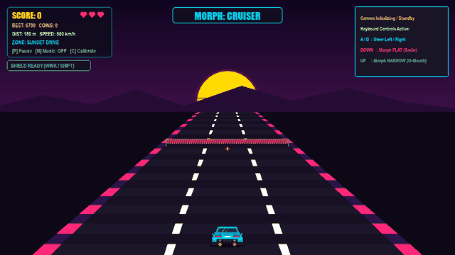

# Shape-Shift Racer

A real-time computer vision arcade game and **468-point facial expression & 3D head pose engine** where your face steers, morphs, jumps, and shields a GT sports car in real time.



---

## Table of Contents

1. [What the Project Does](#what-the-project-does)
2. [Project Structure](#project-structure)
3. [Installation](#installation)
4. [Configuration](#configuration)
5. [How to Run](#how-to-run)
6. [Testing & Verification](#testing--verification)
7. [Python API Reference](#python-api-reference)
8. [License & Acknowledgements](#license--acknowledgements)

---

## What the Project Does

This repository combines two components built around fast, lightweight facial landmark geometry:

### 1. Shape-Shift Racer (Face-Controlled Morphing Car Game)
A 2.5D Pygame arcade game where your live webcam feed controls every aspect of a GT sports car in real time:
- **Big Smile** → Morphs the car into a slammed, wide **FLAT (`LOW-RIDER`)** supercar to slide underneath low horizontal barriers.
- **Open Mouth ("O" / "AH")** → Morphs the car into a tall, ultra-slim **NARROW (`SLIM-BLADE`)** concept car to squeeze between tight vertical pillars.
- **Raise Eyebrows** → Launches the car into a **JUMP** over red ground laser strips and grabs mid-air coins.
- **Asymmetric Wink** → Activates a glowing **Energy Shield + Nitro Speed Boost** to smash straight through obstacles for bonus points (ignores normal two-eye blinks).
- **Neutral Relaxed Face** → Restores the balanced **NORMAL (`CRUISER`)** GT coupe.
- **3D Head Turn / Tilt (`cv2.solvePnP`)** → Steers smoothly across 3 lanes for shifted pillar slits, double-lane roadblocks, and curved synthwave biomes.
- **3-Step Personalized Calibration Wizard** → Captures your exact **Neutral → Smile → Open-Mouth** facial ranges in ~6 seconds on startup.

#### Dual-Stage Vision + 3D Pose Architecture
To keep gameplay locked at 60 FPS with zero stutter, computer vision runs on a dedicated daemon thread (`game/expression_worker.py`):

```text
[Webcam Feed (OpenCV + Auto Low-Light Boost)]
        │
        ▼
[Stage 1: SCRFD 500M ONNX (320×320, OpenCV DNN)] ──► Face Bounding Box
        │
        ▼
[Stage 2: 468-Point 3D FaceMesh ONNX (192×192, ONNX Runtime, ~2 ms)]
        │
        ├──► Stage 3: cv2.solvePnP (6 Canonical 3D Landmarks) ──► 3D Roll/Yaw/Pitch + XYZ Nose Axes
        ├──► Multi-Signal Expression Geometry (Upper-Lip Smile Lift, MAR, Jaw Drop, Brow Raise, EAR Wink)
        │
        ▼
[Velocity-Adaptive One-Euro Filters + Hysteresis Debouncing]
        │
        ▼
[Pygame Main Thread (60 FPS)] ──► Curved Biomes, Morphing GT Car, Jump/Shield, Synthwave Audio, PiP HUD
```

### 2. Standalone Face Pose & Smile Estimation Demos (`Face_Pose/`)
Includes standalone real-time OpenCV webcam scripts implementing two geometric pose estimation methods (without heavy pose-regression networks):
- **Method 1 (Pixel-Ratio Heuristics)**: Relative landmark distances for Roll (`-50` to `+50`), Yaw (`-100` to `+100`), and Pitch (`0` to `4`).
- **Method 2 (Angular Degrees)**: Roll-normalized Euler approximations in degrees (`-90°` to `+90°`) calibrated against NIST Face Image Quality guidelines.
- **Smile Detection**: Mouth-corner span divided by inter-pupillary distance.
- **Supported Detector Backends**: `SCRFD` (ONNX), `RetinaFace MobileNetV2` (TensorFlow SavedModel / ONNX), and `MTCNN` (local TensorFlow implementation).

---

## Project Structure

```text
Shape-Shift-Racer/
├── run_game.py                      # Main entrypoint for Shape-Shift Racer
├── play_game.bat                    # One-click Windows launcher (Python 3.11)
├── requirements.txt                 # Core Python dependencies
├── README.md                        # Project documentation
├── assets/
│   └── demo.gif                     # Animated gameplay preview GIF
├── game/                            # Game engine & dual-stage vision API
│   ├── __init__.py
│   ├── config.py                    # Display, biomes, car shapes, speeds, streak tiers
│   ├── filters.py                   # Velocity-adaptive One-Euro Filter
│   ├── pose_3d.py                   # 3D cv2.solvePnP head pose & RGB nose axes
│   ├── expression_worker.py         # SCRFDDetector, FaceMesh468, ExpressionWorker
│   ├── car.py                       # Rear-view GT sports car, jump physics & shield dome
│   ├── obstacles.py                 # LowBeam, PillarGate, LaserStrip, RoadBlock, Coins, Gauntlets
│   ├── road.py                      # 2.5D curved synthwave road & dynamic biome renderer
│   ├── sound_manager.py             # Procedural stereo SFX & looping synthwave soundtrack
│   └── storage.py                   # Persistent Top-5 high scores & sensitivity settings
├── tests/                           # Automated pytest test suite
│   ├── test_filters_and_pose.py
│   ├── test_vision_and_expressions.py
│   └── test_game_mechanics.py
└── Face_Pose/                       # Standalone pose estimation demos & weights
    ├── pose_detection_scrfd.py      # Standalone SCRFD ONNX detector demo
    ├── pose_detection_retinaface.py # Standalone RetinaFace pose & smile demo
    ├── pose_detection_mtcnn.py      # Standalone MTCNN pose & smile demo
    ├── models/
    │   ├── face_mesh.onnx           # 468-point 3D FaceMesh ONNX (2.3 MB)
    │   ├── scrfd_500m_kps.onnx      # Lightweight SCRFD face detector (2.5 MB)
    │   ├── scrfd_2.5g_kps.onnx      # Medium SCRFD face detector (3.3 MB)
    │   ├── scrfd_10g_kps.onnx       # High-accuracy SCRFD face detector (16.9 MB)
    │   ├── tf-serving-retinaface_mbv2.onnx
    │   └── tf_retinaface_mbv2/      # TensorFlow SavedModel for RetinaFace
    └── mtcnn/                       # Bundled MTCNN implementation & weights
```

---

## Installation

### Prerequisites
- **Python 3.11** (recommended for full compatibility with `pygame`, `opencv-python`, and `onnxruntime`)
- A **webcam** (optional — full keyboard fallback controls are built in)

### Step-by-Step Setup

1. **Clone the repository**
   ```bash
   git clone https://github.com/Sarthak003khurana/Shape-Shift-Racer.git
   cd Shape-Shift-Racer
   ```

2. **Create and activate a virtual environment**
   ```powershell
   # Windows (PowerShell)
   python -m venv .venv
   .\.venv\Scripts\Activate.ps1
   ```
   ```bash
   # macOS / Linux
   python3 -m venv .venv
   source .venv/bin/activate
   ```

3. **Install core dependencies**
   ```bash
   pip install -r requirements.txt
   ```
   `requirements.txt` installs:
   - `pygame>=2.6.0`
   - `opencv-python==4.10.0.84`
   - `numpy>=1.23.0`
   - `onnxruntime>=1.18.0`

4. **(Optional) Dependencies for legacy TensorFlow demos**
   Only required if you want to run `Face_Pose/pose_detection_mtcnn.py` or `Face_Pose/pose_detection_retinaface.py`:
   ```bash
   pip install tensorflow
   ```

---

## Configuration

### 1. Game & Visual Settings (`game/config.py`)
All gameplay, physics, and visual parameters live in [`game/config.py`](game/config.py):

| Constant | Default | Description |
| :--- | :--- | :--- |
| `SCREEN_WIDTH`, `SCREEN_HEIGHT`, `FPS` | `1280`, `720`, `60` | Window resolution and target frame rate. |
| `CAR_SHAPES["NORMAL"]` | `84 × 50` px | Standard Cruiser width, height, and neon color. |
| `CAR_SHAPES["FLAT"]` | `136 × 22` px | Low-Rider dimensions when smiling. |
| `CAR_SHAPES["NARROW"]` | `32 × 100` px | Slim-Blade dimensions when making an "O" mouth. |
| `LOW_BEAM_GAP_HEIGHT` | `30` px | Vertical clearance under `LowBeam` obstacles (only `FLAT` fits). |
| `PILLAR_GAP_WIDTH` | `48` px | Horizontal gap between `PillarGate` pillars (only `NARROW` fits). |
| `BASE_SPEED`, `SPEED_INCREMENT`, `MAX_SPEED` | `420.0`, `12.0`, `900.0` | Starting speed, acceleration per passed obstacle, and speed cap. |
| `PIP_WIDTH`, `PIP_HEIGHT`, `PIP_X`, `PIP_Y` | `260 × 195` | Top-right webcam Picture-in-Picture overlay geometry. |

### 2. Vision & Expression Settings (`game/expression_worker.py`)
Configure camera selection, models, and sensitivity in [`game/expression_worker.py`](game/expression_worker.py):

- **Camera Index**: Pass `camera_id=0` (internal webcam) or `camera_id=1` (external USB webcam) to `ExpressionWorker(...)` in `run_game.py`.
- **Detector Model**: Swap `scrfd_500m_kps.onnx` (fastest) for `scrfd_2.5g_kps.onnx` or `scrfd_10g_kps.onnx` (highest accuracy) via `model_path`.
- **Confidence & NMS Thresholds**: `SCRFDDetector(onnx_path, conf_thresh=0.35, nms_thresh=0.45)`. Lower `conf_thresh` (e.g. `0.25`) for very dark rooms.
- **Expression Hysteresis**: In `ExpressionWorker._update_shape_hysteresis()`, adjust `enter_thresh = 0.48` (trigger point) and `exit_thresh = 0.34` (release point) to make morphing more or less sensitive.
- **Steering Deadzone**: In `ExpressionWorker._run_loop()`, adjust `if abs(raw_steer) < 0.10: raw_steer = 0.0` to widen or tighten center-lane stability.
- **Neutral Baseline Calibration**: Automatically collects 30 frames on startup and whenever you press `C` in-game (`calibration_target_count = 30`).

### 3. Standalone Demo Settings (`Face_Pose/*.py`)
Inside `pose_detection_mtcnn.py` and `pose_detection_retinaface.py`, you can toggle:
- `camera = 0` (`0`: built-in, `1`: external webcam)
- `video_save = False` (set `True` to record `video_out.avi` at `fps = 10.0`)

---

## How to Run

### Run Shape-Shift Racer
- **Command line**:
  ```bash
  python run_game.py
  ```
- **Windows One-Click**:
  Double-click [`play_game.bat`](play_game.bat) in File Explorer. *(Update the Python path inside `play_game.bat` if your Python 3.11 executable is in a different location.)*

#### Game Controls
| Input | Action |
| :--- | :--- |
| **Big Smile** | Morph car **FLAT** (slide under red horizontal beams) |
| **Open Mouth ("O" / "AH")** | Morph car **NARROW** (squeeze through cyan twin pillars) |
| **Raise Eyebrows** | **JUMP** over red ground laser strips |
| **Wink One Eye** | Activate **Energy Shield + Nitro Boost** (smashes blocks!) |
| **Relaxed Neutral Face** | Return to **NORMAL** balanced cruiser |
| **Head Turn / Tilt** | 3D `solvePnP` steering left / right around roadblocks |
| `SPACE` | Start 3-step calibration / skip calibration / Jump (in-game) / restart |
| `J` | Keyboard fallback: **JUMP** |
| `Shift` | Keyboard fallback: **SHIELD + NITRO** |
| `P` | Pause & open live Smile / O-Mouth / Steer sensitivity menu |
| `M` | Toggle procedural synthwave background music ON / OFF |
| `C` | Recalibrate neutral face baseline mid-game |
| `A` / `D` or `←` / `→` | Keyboard fallback: steer left / right |
| `↓` / `S` | Keyboard fallback: morph **FLAT** |
| `↑` / `W` | Keyboard fallback: morph **NARROW** |
| `Q` or `Esc` | Quit game |

### Run Standalone Face Pose Demos
Run from inside the `Face_Pose/` directory so relative model paths resolve cleanly:
```bash
cd Face_Pose
python pose_detection_scrfd.py       # OpenCV DNN + SCRFD ONNX
python pose_detection_retinaface.py  # TensorFlow RetinaFace + Pose & Smile
python pose_detection_mtcnn.py       # TensorFlow MTCNN + Pose & Smile
```
Press `q` in the OpenCV window to exit.

---

## Testing & Verification

### Automated `pytest` Suite (Recommended)
Run all unit & integration tests (One-Euro Filter, 3D `solvePnP`, ONNX models, 3-step calibration, hysteresis, jump/shield physics, obstacles, biomes, audio, and persistence):
```bash
pytest -v
```

### Live Webcam & 468-Point Expression Worker Check
Captures live frames for 2.5 seconds and prints real-time telemetry from `ExpressionWorker`:
```bash
python -c "import time; from game.expression_worker import ExpressionWorker; w=ExpressionWorker(camera_id=0); w.start(); time.sleep(2.5); st=w.get_state(); w.stop(); print({k: round(v,3) if isinstance(v,float) else v for k,v in st.items() if k!='pip_rgb_bytes'})"
```
Expected output when seated in front of your webcam:
```python
{'steer_x': 0.0, 'shape': 'NORMAL', 'face_detected': True, 'camera_available': True, 'smile_intensity': 0.01, 'open_intensity': 0.05, 'is_calibrating': False, 'fps': 28.5}
```

---

## Python API Reference

This project exposes a clean, reusable **Python API** (no external web server required) so you can embed real-time face detection, 468-point facial landmarks, and expression/pose telemetry into your own applications.

### 1. `ExpressionWorker` (High-Level Threaded Expression & Steering API)
Located in `game.expression_worker`. Runs webcam capture + SCRFD + 468-point FaceMesh in a background thread.

```python
import time
from game.expression_worker import ExpressionWorker

worker = ExpressionWorker(
    model_path="Face_Pose/models/scrfd_500m_kps.onnx",
    mesh_path="Face_Pose/models/face_mesh.onnx",
    camera_id=0,
)
worker.start()
worker.trigger_calibration()  # Optional: re-baseline neutral face

try:
    for _ in range(50):
        state = worker.get_state()
        if state["face_detected"]:
            print(
                f"Shape={state['shape']:<6} | "
                f"Steer={state['steer_x']:+.2f} | "
                f"Smile={state['smile_intensity']:.2f} | "
                f"Open={state['open_intensity']:.2f} | "
                f"FPS={state['fps']:.1f}"
            )
        time.sleep(0.1)
finally:
    worker.stop()
```

#### `worker.get_state()` Return Schema
| Key | Type | Range / Values | Description |
| :--- | :--- | :--- | :--- |
| `steer_x` | `float` | `-1.0` to `+1.0` | Smoothed horizontal steering (`-1.0` left, `+1.0` right). |
| `shape` | `str` | `"NORMAL"`, `"FLAT"`, `"NARROW"` | Hysteresis-debounced vehicle morph state. |
| `face_detected` | `bool` | `True` / `False` | Whether a face was detected in the latest frame. |
| `camera_available` | `bool` | `True` / `False` | Whether the webcam opened successfully. |
| `smile_intensity` | `float` | `0.0` to `1.0` | Normalized smile strength (width expansion + corner lift). |
| `open_intensity` | `float` | `0.0` to `1.0` | Normalized mouth opening strength (inner-lip MAR). |
| `is_calibrating` | `bool` | `True` / `False` | `True` while collecting neutral baseline samples. |
| `fps` | `float` | `>= 0.0` | Current vision pipeline frame rate. |
| `pip_rgb_bytes` | `bytes \| None` | `PIP_WIDTH * PIP_HEIGHT * 3` | Annotated RGB frame bytes ready for `pygame.image.frombuffer(...)`. |

---

### 2. `SCRFDDetector` & `FaceMesh468` (Low-Level Frame Inference API)
Use these directly to run face detection and 468-point landmark extraction on any OpenCV BGR image (`numpy.ndarray`) without threads or a webcam:

```python
import cv2
from game.expression_worker import SCRFDDetector, FaceMesh468

detector = SCRFDDetector("Face_Pose/models/scrfd_500m_kps.onnx", conf_thresh=0.35, nms_thresh=0.45)
mesh = FaceMesh468("Face_Pose/models/face_mesh.onnx")

img_bgr = cv2.imread("path/to/photo.jpg")

# Stage 1: Detect faces -> bboxes: (N, 4) [x, y, w, h], kpss: (N, 5, 2)
bboxes, kpss = detector.detect(img_bgr)

if len(bboxes) > 0:
    # Stage 2: Extract 468 facial landmarks -> (468, 2) pixel coordinates
    landmarks_468 = mesh.predict(img_bgr, bboxes[0])
    nose_tip = landmarks_468[1]
    left_mouth_corner = landmarks_468[61]
    right_mouth_corner = landmarks_468[291]
    upper_inner_lip = landmarks_468[13]
    lower_inner_lip = landmarks_468[14]
    print("Nose tip:", nose_tip, "Lip gap (px):", abs(lower_inner_lip[1] - upper_inner_lip[1]))
```

---

### 3. Game Engine Components (`game.*`)
If extending or customizing the game:
- `game.car.Car`: `.set_target_steer(norm_x)`, `.set_shape(shape_key)`, `.update(road_renderer, dt)`, `.render(screen)`, `.get_hitbox() -> pygame.Rect`
- `game.road.RoadRenderer`: `.update(speed, dt)`, `.render(screen)`, `.get_screen_coords(normalized_x, world_z) -> (screen_x, screen_y, scale)`
- `game.obstacles.ObstacleManager`: `.update(speed, dt, car, sound_mgr) -> (points, collision)`, `.render(screen, road_renderer)`, `.reset()`
- `game.sound_manager.SoundManager`: `.play(sound_name)` where `sound_name` is `"morph"`, `"clear"`, `"crash"`, or `"calibrated"`.

---

### 4. Standalone 5-Point Pose Functions (`Face_Pose/`)
The standalone scripts (`Face_Pose/pose_detection_retinaface.py` and `Face_Pose/pose_detection_mtcnn.py`) implement pure NumPy geometric helpers operating on a 10-element landmark vector `[x0..x4, y0..y4]`:
- `find_pose(points) -> (roll_deg, yaw_deg, pitch_deg)` — Roll-normalized pose angles in degrees (`-90°` to `+90°`).
- `find_roll(points)`, `find_yaw(points)`, `find_pitch(points)` — Method 1 relative pixel-ratio heuristics.
- `find_smile(points) -> float` — Ratio of mouth width to inter-eye width (`> 0.85`–`0.90` indicates smiling).

---

## License & Acknowledgements

- See [`Face_Pose/LICENSE.md`](Face_Pose/LICENSE.md) for the base `Face_Pose` license terms.
- Face detection & landmark models:
  - **SCRFD** (InsightFace)
  - **MediaPipe 468-Point FaceMesh** (ONNX export)
  - **RetinaFace MobileNetV2** (`peteryuX/retinaface-tf2`)
  - **MTCNN** (`ipazc/mtcnn`)
